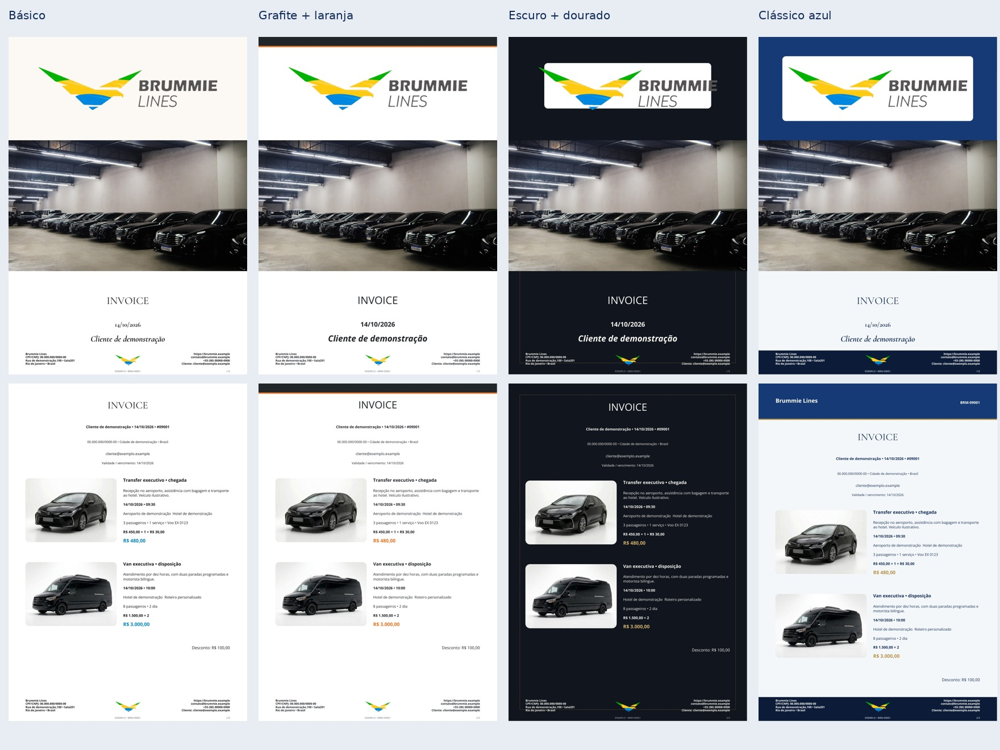
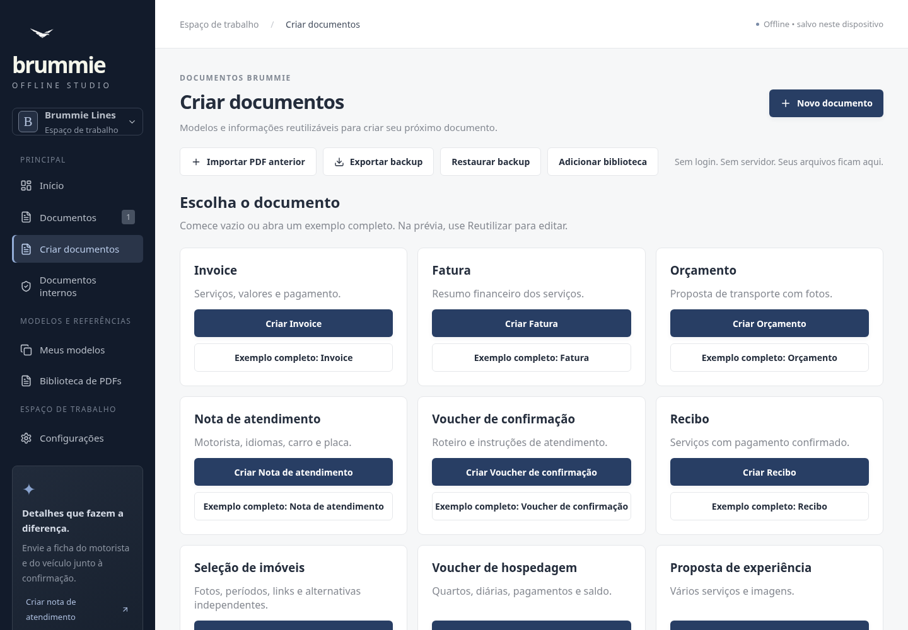
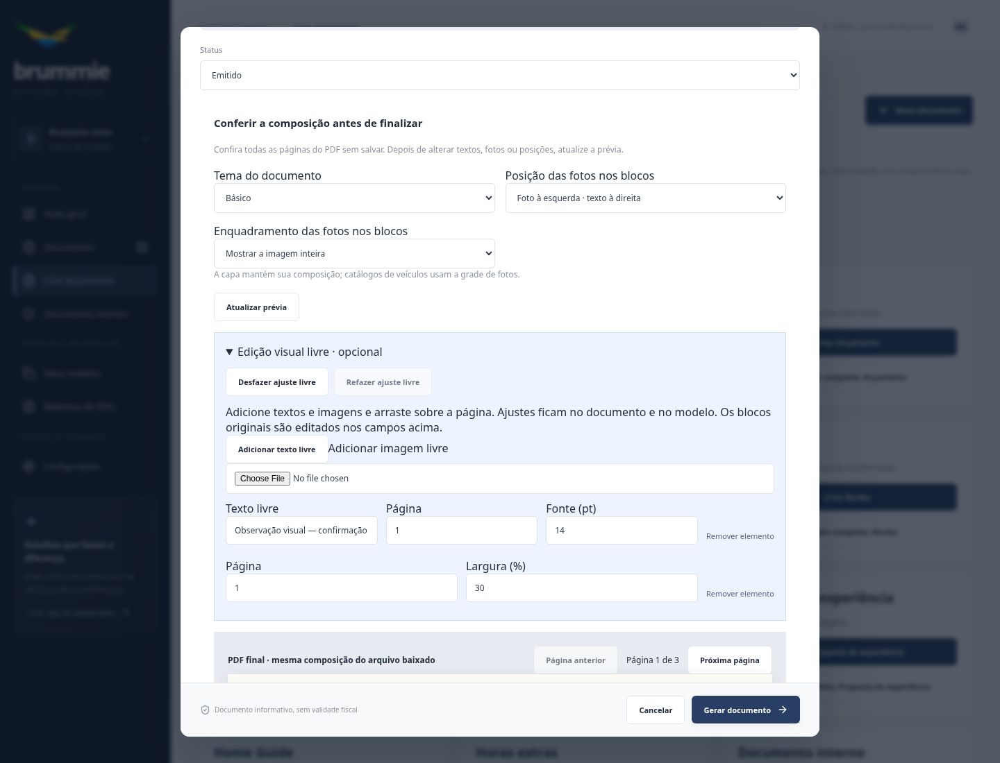
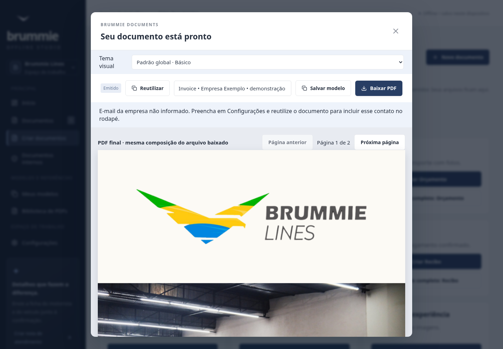
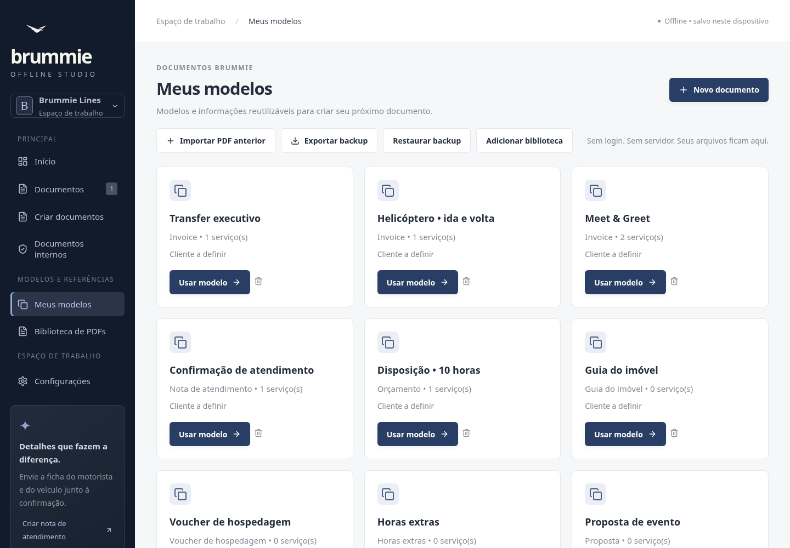
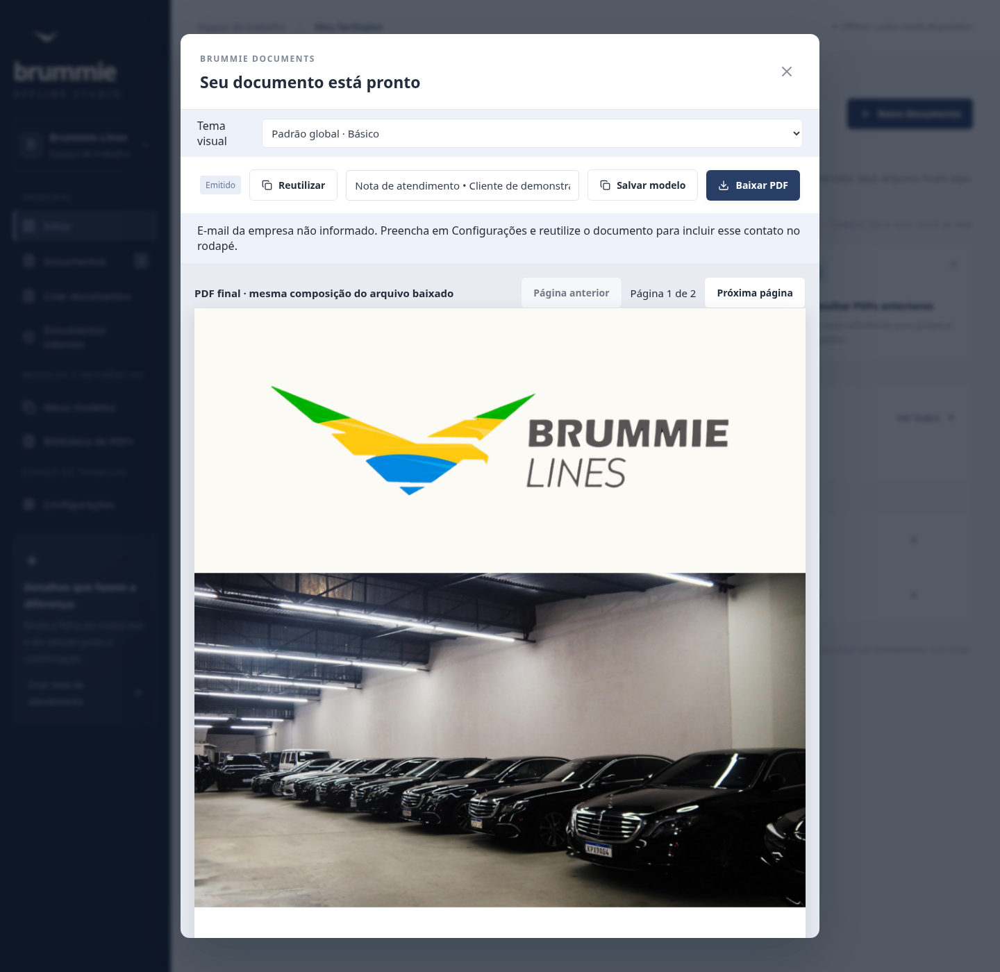
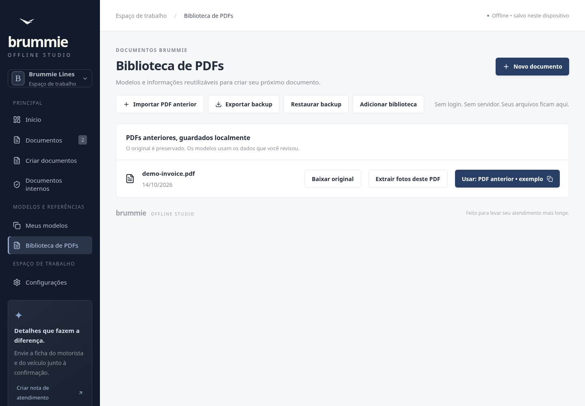
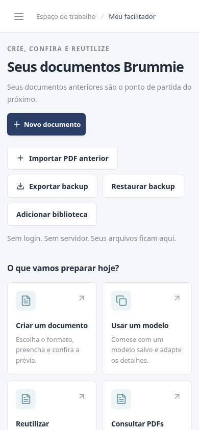

# Brummie Offline Studio

**Seu próximo documento começa com o que você já fez.**

Um facilitador para transporte executivo: transforme serviços recorrentes e PDFs anteriores em novos invoices, faturas, orçamentos e confirmações de atendimento. Guarde seus modelos, reutilize informações e gere documentos em português ou inglês — mesmo sem internet.

**Offline · PDF · Modelos reutilizáveis · Windows e Android**

[Pesquisa de design e critérios profissionais](docs/design-research.md) · [Comparar antes e depois](docs/examples/README.md)

**[Abrir galeria: 60 documentos completos em imagens](docs/examples/README.md)** — 15 formatos, quatro temas e todas as páginas, sem baixar o app.

[](docs/examples/README.md)

[Baixar o HTML para testar](https://github.com/carlosredbox-hub/Brummie-Notes/raw/refs/heads/main/docs/demo/Brummie-Offline.html) · [Instaladores Windows e Android](https://github.com/carlosredbox-hub/Brummie-Notes/releases/tag/v1.4.2)



O app é um criador de documentos: a abertura oferece criar, usar modelos, reutilizar documentos e consultar PDFs. Indicadores de contas a receber/pagamentos e alteração de status na prévia foram retirados.

## Do atendimento ao documento, com menos preenchimento

- **Reutilize o que funciona.** Salve um modelo e preencha o próximo documento com cliente, serviços, valores, motorista e veículo anteriores. Revise as datas e emita.
- **Leve o histórico junto.** Importe PDFs, preserve os originais e crie modelos a partir das informações revisadas.
- **Apresente o atendimento.** Envie uma nota com os dados do motorista bilíngue e do veículo; os cadastros também aceitam fotos.
- **Trabalhe offline.** Dados ficam no dispositivo. Backup permite levar a biblioteca para outro computador ou celular.

O ícone enviado em `Brummie Icon.png` é usado no app, aba do navegador, Windows (EXE, instalador, atalhos e janela) e Android (ícones adaptativo e temático). Para atualizar as imagens derivadas, execute `python scripts/generate-icons.py` com Pillow instalado.

A interface agora tem textos e controles maiores; Windows abre maximizado. A saudação genérica foi substituída por “Seus documentos Brummie”. A logo branca identifica apenas o app; as marcas coloridas dos PDFs permanecem intactas. Android TEST1.4.2 instala lado a lado com versões anteriores para evitar conflito de assinaturas temporárias, preservando seus dados; use backup para transferir a biblioteca.

**Novo: [roteiro por dia e período](docs/itinerary.md)** — agenda editável, notas do concierge e [exemplo completo em imagens](docs/examples/roteiro-agenda.md).

## Criar, conferir e ajustar

Uma única tela **Criar documentos** reúne 15 formatos, cada um com **Criar** e **Exemplo completo**. Os exemplos são fictícios, incluem vários serviços/fotos e não alteram a biblioteca.

Escolha **Básico**, **Grafite + laranja**, **Escuro + dourado** ou **Clássico azul**. Configurações define o padrão de todos os documentos; cada documento pode ter uma escolha própria. Fotos, textos, valores, links e contatos continuam presentes. A composição lateral foi retirada para evitar metadados duplicados; a capa não recebe preços automáticos. O ícone branco é exclusivo do app: cabeçalhos e rodapés dos PDFs usam as marcas coloridas anteriores.

Antes de salvar, **Visualizar antes de finalizar** mostra as páginas do próprio PDF. Ajuste o lado das fotos e o enquadramento, atualize a prévia e, se desejar, abra **Edição visual livre**: adicione texto/imagem, arraste, redimensione, desfaça/refaça e salve os ajustes no documento/modelo. [Detalhes e referência PdfCraft](docs/visual-editor.md). Perfil de usuário removido; funcionamento local sem conta.



A [execução da release 1.4](https://github.com/carlosredbox-hub/Brummie-Notes/actions/runs/38444020828) passou em validação, Windows, Android e publicação. HTML da release conferido por SHA256; APK de teste e Windows sem assinatura de distribuição.

## Revisão visual no Studio 1.4

Guias de hospedagem com QR de Wi-Fi e exportação HTML, vouchers de hotel com quartos/diárias/pagamentos, propostas de experiências e relatórios de horas extras agora têm editores próprios. Brummie Lines e Real Estate usam perfis de identidade editáveis e capas opcionais. PDFs originais podem ser anexados ao documento.

**Documentos internos** ficam em uma área própria, como moldes editáveis de fechamento e repasse, com aviso de confidencialidade. Não aparecem no painel de clientes. Adicional de cartão opcional, desligado por padrão, aparece separado no documento quando selecionado.

**Adicionar biblioteca** importa pacotes privados de forma aditiva, preservando os dados existentes. Esses pacotes não são publicados no GitHub. O HTML e os instaladores da release v1.4.0 incluem a revisão visual. Clientes, motoristas e frota ficam em Configurações. A colaboração Atlas/Aurum está registrada nos arquivos `Chat 8 - Codex.md` e `Chat 8 - Claude.md`.


**Composição baseada nos PDFs enviados:** capa fotográfica, Open Sans e Cormorant incorporadas, fotos ao lado do texto, rodapé com endereço/logo/contato e prévia que renderiza o PDF final. **Property Selection** permite várias opções de hospedagem com valores independentes. Fotos de serviços, experiências, quartos e guias ficam nos modelos. Em Biblioteca de PDFs, use **Extrair fotos deste PDF** para reutilizá-las nos editores; extração local de imagens raster, sem OCR ou reconstrução de páginas escaneadas.

## Veja o app em uso

### Invoice pronto para baixar

Itens, trechos, adicionais e desconto reunidos em um PDF. Também emite fatura, orçamento, voucher, nota informativa e recibo.



### Modelos que aceleram o próximo serviço

Transfer, helicóptero, Meet & Greet e disposição são pontos de partida editáveis. Ao reutilizar um roteiro, o app mantém os intervalos entre as datas dos serviços.



### Cliente informado sobre o atendimento

Motorista, idiomas e placa em uma nota de atendimento. Nome, foto do motorista e foto do carro podem ser incluídos pelos cadastros.



### PDFs anteriores viram memória de trabalho

O original permanece guardado; um mesmo PDF pode ter modelos separados para alternativas de serviço. Campos sugeridos precisam ser revisados.



### A mesma interface no celular



_Screenshots reais do app, com dados fictícios de demonstração. A imagem móvel mostra a interface responsiva no navegador; não representa teste em um aparelho Android físico._

## Escolha como testar

O [HTML único](https://github.com/carlosredbox-hub/Brummie-Notes/raw/refs/heads/main/docs/demo/Brummie-Offline.html) abre no Chrome/Edge, sem instalar o app nem configurar servidor. A [release v1.4.0](https://github.com/carlosredbox-hub/Brummie-Notes/releases/tag/v1.4.2) também inclui Windows EXE/ZIP e Android APK de teste. O workflow valida e gera os pacotes Windows e Android; acompanhe a execução da versão na aba Actions.

Cada dispositivo guarda sua própria biblioteca. Transfira dados por backup; não há sincronização automática. A restauração substitui os dados existentes após confirmação. A distribuição pública inclui modelos genéricos; sua biblioteca privada é carregada por backup. Os documentos são informativos, sem integração fiscal oficial.

## Testar antes de instalar

```sh
npm ci
npm run build
```

Abra `dist/index.html` em Chrome ou Edge. O arquivo único contém interface, ícone, gerador de PDF e leitor de PDFs. Não precisa de arquivos auxiliares. Use sempre o mesmo navegador e endereço/caminho para manter o espaço local; exporte backup antes de mover o HTML. Navegação privada ou limpeza de dados do navegador pode apagar seus registros.

- **Meus modelos:** exemplos editáveis baseados nos documentos fornecidos e modelos que você salvar. Reutilizar preenche cliente, serviços, valores, motorista e veículo; reposiciona as datas a partir de hoje, mantendo os intervalos entre serviços, para revisão.
- **Importar PDF anterior:** preserva o arquivo original na biblioteca e extrai texto localmente. Revise cliente, descrição e valor antes de salvar o modelo. A sugestão de preço usa o maior valor monetário encontrado; não reconstrói todas as linhas automaticamente. PDFs digitalizados precisam de preenchimento manual, sem OCR. Limite: 25 MB e 150 páginas, sem senha.
- **Novo documento:** cadastros locais, itens, adicionais, descontos e emissão de PDF. Clientes utilizados ficam memorizados. Nota de atendimento permite nome, idiomas e foto do motorista, foto e placa do veículo. Não há emissão fiscal oficial.
- **Exportar backup / Restaurar backup:** inclui documentos, modelos, cadastros, fotos e PDFs originais. A restauração substitui os dados locais após confirmação (máximo 150 MB). Guarde o backup em local privado.

Se o visualizador bloquear o armazenamento, o app entra em **modo de prévia em memória**, com aviso visível. Nesse modo as alterações duram somente enquanto a página estiver aberta; exporte backup antes de fechar. Se o visualizador não executar JavaScript, abra o HTML no Chrome/Edge.

No modo normal, dados ficam no IndexedDB do dispositivo. O armazenamento disponível depende do navegador e do espaço em disco. Windows e Android usam o mesmo app, mas cada dispositivo tem sua própria biblioteca: transfira um backup para levar os dados ao outro dispositivo. Não há sincronização automática offline.

## Desenvolvimento e validação

Node.js 24. `npm run dev` inicia Vite na porta 3000 para desenvolvimento; `npm start` serve a compilação local. Esses comandos são opcionais para o HTML pronto. `npm run desktop` abre a versão Electron após o build.

```sh
npm test
npm run build
npm run test:browser
npm run test:preview
```

O teste de navegador roda com rede desativada e verifica emissão de PDF, persistência, reutilização, importação, preservação exata do PDF original, backup em outro contexto e layout móvel. Chromium/Playwright deve estar instalado. Testes legados de API ainda verificam o backend histórico em `server.js`; ele não é usado pelo app offline nem empacotado nos instaladores. Esses testes exigem a fonte DejaVuSans.

Veja [plataformas e releases](docs/PLATAFORMAS.md) e [referências dos documentos](docs/REFERENCIAS.md). Os anexos originais e dados pessoais não são publicados no Git nem na release genérica. O [HTML com biblioteca privada](docs/BIBLIOTECA.md) incorpora os documentos autorizados pelo usuário apenas no arquivo local de avaliação.

## Atualizar as screenshots

```sh
npm run build
node scripts/capture-screenshots.mjs
```

A captura usa um navegador isolado, rede desativada e dados fictícios; não altera a biblioteca do usuário. O HTML público de demonstração está em `docs/demo/Brummie-Offline.html`. O HTML de demonstração acompanha a branch main; os instaladores são gerados a partir da tag da release.

Histórico também simplificado: retiradas colunas VALOR/STATUS para não parecer contas a receber. Valores e estado continuam nos dados/documentos, sem apagar arquivos ou alterar cálculo de invoice/recibo.
