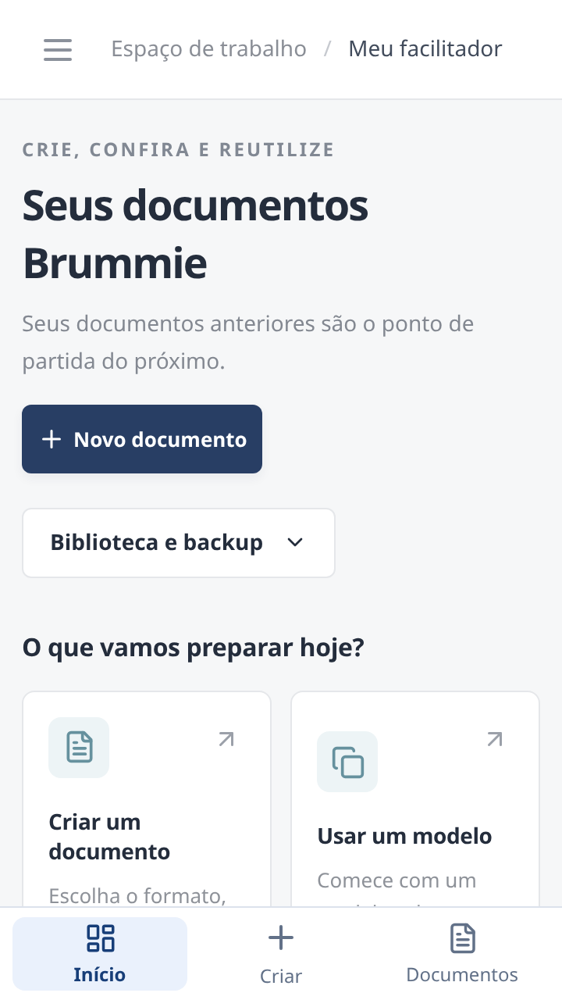
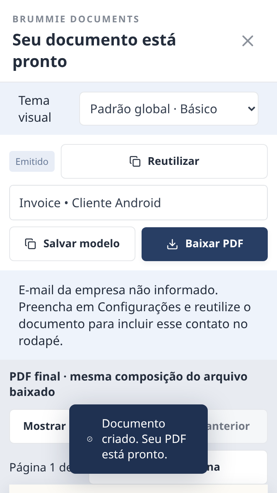

# Android: uma interface para o celular

A versão 2.0.2 adapta a interface ao uso no celular, mantendo o mínimo Android 8 e o funcionamento offline. A instalação continua sendo um APK TEST com identificador separado por versão; não substitui instalações anteriores nem suas bibliotecas.

- Navegação inferior: Início, Criar e Documentos.
- Biblioteca e backup agrupados para deixar a criação à frente.
- Editor ocupa a tela; cabeçalho e ações ficam acessíveis enquanto o conteúdo rola.
- Ajuste de altura com o teclado aberto e campos de pelo menos 16 px.
- Voltar primeiro fecha o teclado; na edição, pede confirmação antes de descartar.
- Rotação preserva a atividade e o formulário. Isso não equivale a recuperar uma edição após o Android encerrar o processo.
- Sem a barra de título nativa duplicada; margens tratam barras do sistema e recortes em Android 15.
- Decodificação e escrita de arquivos fora da thread da interface. Depois de salvar um PDF pelo seletor Android, é possível abrir o compartilhamento nativo; nenhum arquivo é enviado sem escolha do usuário.
- O app continua sem permissão INTERNET e sem acesso amplo ao armazenamento.

## Imagens da interface

Capturas do fluxo touch em 360×640, no Chromium de teste. Elas mostram o layout do app; não são fotografias de um Galaxy S7 Edge.

| Início | Prévia |
| --- | --- |
|  |  |

## Verificação

O teste mobile cobre navegação por toque, menu/Voltar, viewport reduzido como com teclado, rotação, preservação dos campos e geração de PDF offline. O teste de instalação do APK cobre API26 e API35. Em API35, um roteiro adicional usa o teclado real do emulador e confere ações acima dele, confirmação de Voltar e retenção do texto. Publicação fica condicionada aos testes; consulte a execução da release para o resultado, sem inferi-lo do build local.

No Android 8, o WebView/Chrome precisa estar atualizado (107+); com motor antigo, aparece uma orientação nativa. Enviar o PDF a um aplicativo de terceiro ainda depende dos aplicativos instalados e deve ser conferido no dispositivo físico.
