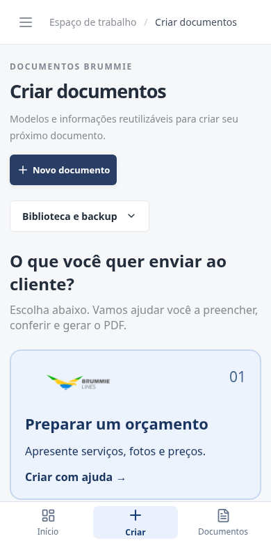
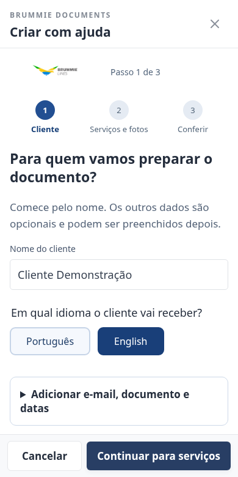
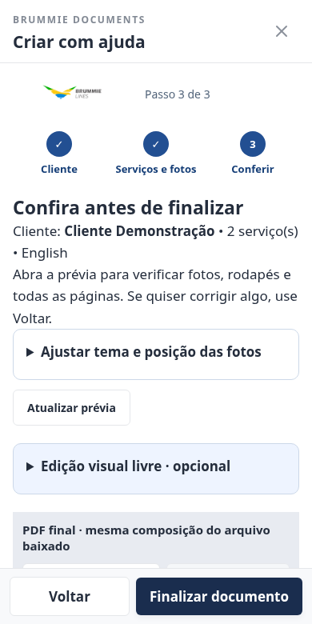
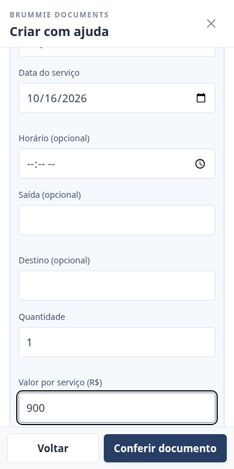
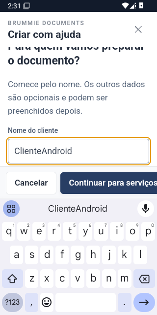
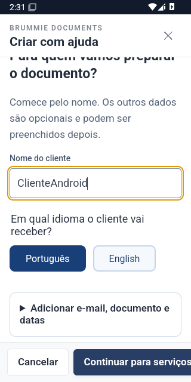

# Criar com ajuda — 2.0

A revisão encontrou três barreiras: catálogo com quinze escolhas equivalentes, muitos campos simultâneos e pouca distinção entre o necessário e o opcional. O novo início destaca tarefas do cliente, com botões grandes e identificação da marca antes de abrir o documento.

Orçamento, invoice e nota de atendimento têm um caminho guiado:

1. **Cliente:** nome e escolha entre português e inglês. Contatos e datas ficam em um grupo opcional; clientes salvos podem preencher os dados.
2. **Serviços e fotos:** um cartão por serviço, com saída, destino, horário, valor e upload de foto. É possível adicionar vários cartões. Motorista e veículo ficam em um grupo separado.
3. **Conferir:** prévia real de todas as páginas antes de salvar. Voltar preserva os dados. Tema, posição e enquadramento das fotos continuam ajustáveis.

A edição completa mantém todos os campos anteriores e recebe os dados já digitados ao sair do modo guiado. Os outros modelos, incluindo imóveis, hospedagem, roteiro e tarifário, continuam no catálogo com exemplos completos. Esta primeira versão guiada cobre os três caminhos destacados; os outros modelos ainda usam seus editores específicos.

As janelas de edição recebem o foco de teclado e tornam o conteúdo atrás delas inativo. A navegação por Tab permanece dentro da janela.

Foram aplicados textos diretos, botões com área de toque de pelo menos 48 px, campos maiores e divulgação progressiva das opções. Isso melhora a operação, mas não substitui uma rodada de observação com os funcionários que vão usar o app. Próximo passo recomendado: pedir que duas pessoas criem um orçamento sem ajuda e registrar onde hesitam.

O teste offline verifica nome obrigatório, idioma inglês, dois serviços, prévia PDF, retorno sem perda e documento persistido. O fluxo completo anterior e a edição visual livre também continuam testados. Não há login nem servidor; o backup é necessário para transferir dados entre aparelhos.

## Fotos do modo guiado

Capturas com dados fictícios no navegador de teste, tamanho de celular. Não são fotos de um aparelho físico.

| Escolher | Preencher | Conferir |
| --- | --- | --- |
|  |  |  |

## Referências da revisão

- [GOV.UK — Question pages](https://design-system.service.gov.uk/patterns/question-pages/): pedir apenas informações necessárias, permitir voltar e reaproveitar respostas. O assistente agrupa as perguntas por tarefa; não replica integralmente esse padrão.
- [W3C — Target Size (Minimum)](https://www.w3.org/WAI/WCAG22/Understanding/target-size-minimum.html): tamanho e separação dos controles reduzem toques acidentais. As ações principais do novo fluxo têm pelo menos 48 px de altura.
- [W3C — Focus Not Obscured](https://www.w3.org/WAI/WCAG22/Understanding/focus-not-obscured-minimum.html): cabeçalhos e rodapés fixos não devem esconder o campo em uso. O fluxo foi verificado com viewport reduzido e com teclado Android real em emulador.

São referências de projeto; não constituem uma certificação completa de acessibilidade. A observação de uso com os funcionários continua recomendada.

## Teste no Android instalado

Capturas do APK no emulador Android 15, com dados fictícios: teclado aberto e formulário preservado depois de cancelar a saída. O teste de [compatibilidade Android](https://github.com/carlosredbox-hub/Brummie-Notes/actions/runs/38915950342) passou em API26 e API35. A [release 2.0.6](https://github.com/carlosredbox-hub/Brummie-Notes/releases/tag/v2.0.6) também instalou o APK distribuído nos dois emuladores antes de publicar.

| Teclado sem cobrir as ações | Dados preservados ao voltar |
| --- | --- |
|  |  |

Não houve teste físico no Galaxy S7 Edge. Android 8 é o mínimo; o WebView/Chrome precisa estar atualizado (107+). O APK TEST instala separadamente de versões anteriores: transfira sua biblioteca por backup.
