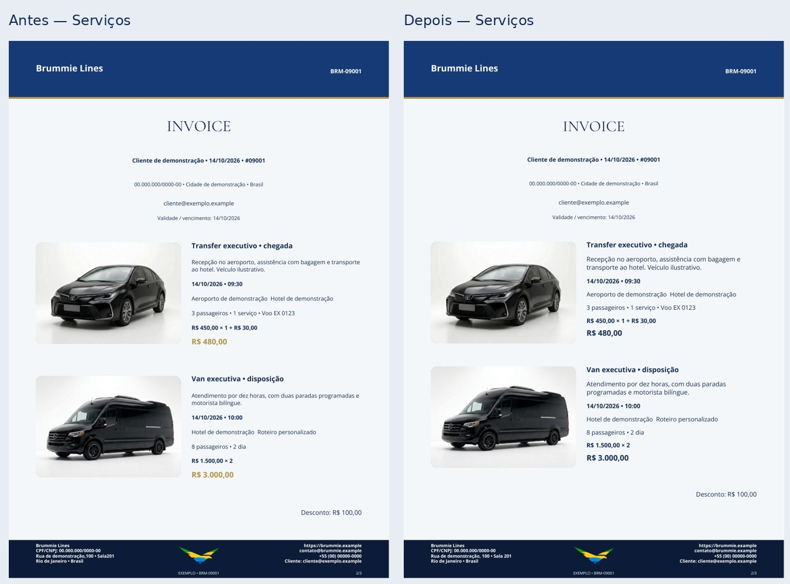
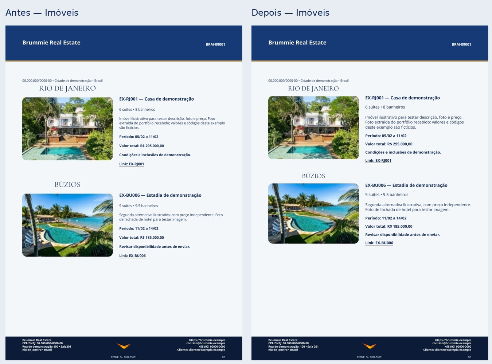
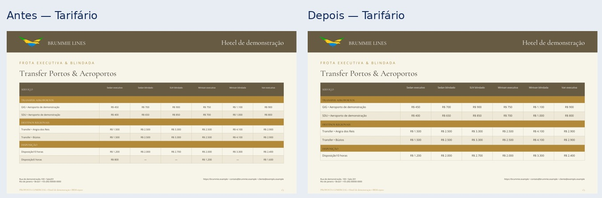
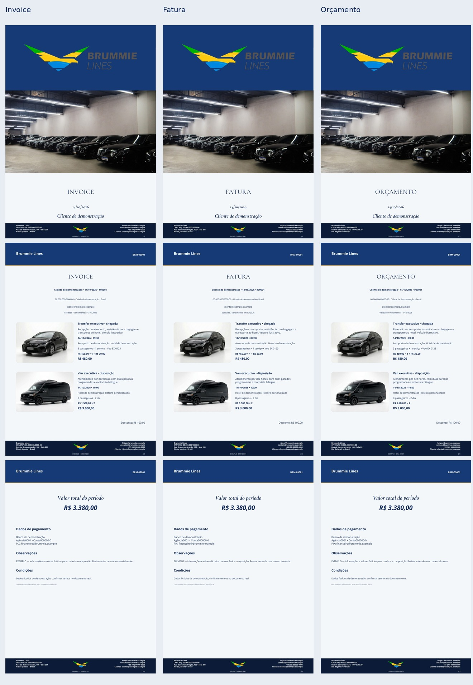
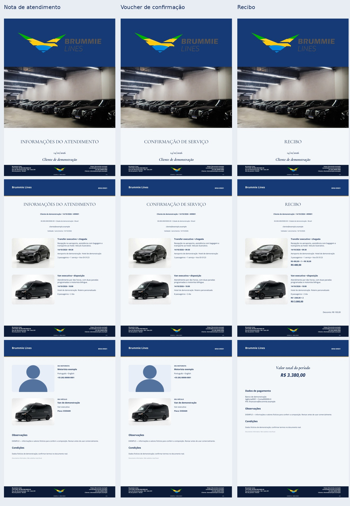
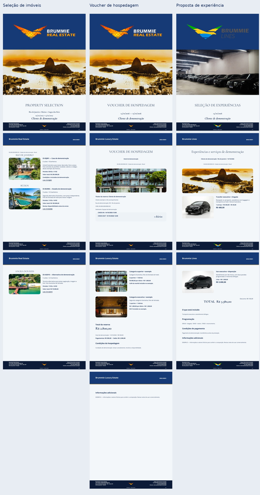
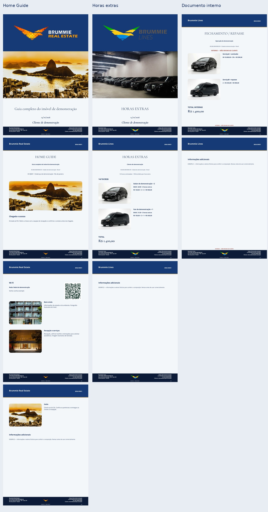
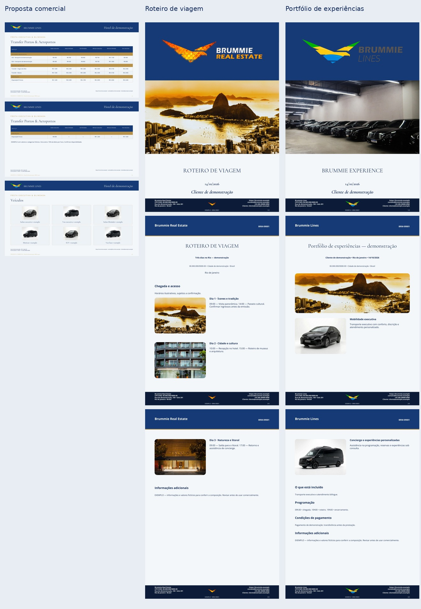

# Galeria visual — Brummie

Fotos do PDF realmente exportado, com dados fictícios e imagens ilustrativas. Os cinco painéis mostram todos os 15 formatos e todas as páginas no tema Clássico azul; o sexto compara quatro temas. O conjunto entregue ao usuário inclui 60 PDFs renderizados em 169 páginas: cada formato nos quatro temas.

**Veja todas as páginas dos 60 exemplos diretamente no GitHub:**

- [15 documentos no tema Básico](basic.md)
- [15 documentos no tema Grafite + laranja](orange.md)
- [15 documentos no tema Escuro + dourado](gold.md)
- [15 documentos no tema Clássico azul](blue.md)

Clique nas imagens para ampliar. Todos os exemplos abaixo mostram documentos completos, com várias páginas e fotos.

## Remasterização discreta — antes e depois

Fontes e estrutura originais preservadas; corpo mais legível, espaçamento e paginação refinados. [Pesquisa e critérios profissionais](../design-research.md) · [Revisão independente de Claude](../visual-review.md)

## Comparação dos quatro temas

A logo branca é exclusiva do app. PDFs usam as marcas coloridas anteriores; Lines tem asset de rodapé separado do ícone do aplicativo. A composição lateral foi retirada; valores não são colocados automaticamente na capa.

As logos transparentes ficam diretamente sobre o fundo do tema, sem retângulo branco adicional nas capas azul e escura.
