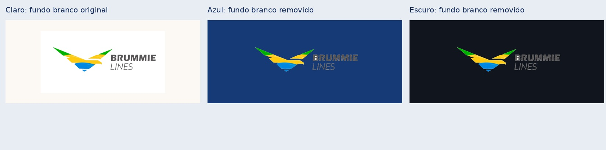

# Logos: preservar o original no fundo certo

Mesmo arquivo de logo com fundo branco opaco: preservado no documento claro, limpo na composição sobre azul/escuro. A marca e as cores são mantidas; O lettering da marca Lines recebe contraste claro em fundos escuros; o branco residual dentro das letras também é removido nessa versão. Logos personalizados não são recoloridos. Esta regra não se aplica às fotografias.

[Detalhes do novo modelo PT/EN](../new-time-reference.md) · [Voltar à galeria](README.md)

[Ver a correção dos espaços internos das letras e do contraste](logo-counters/README.md).
