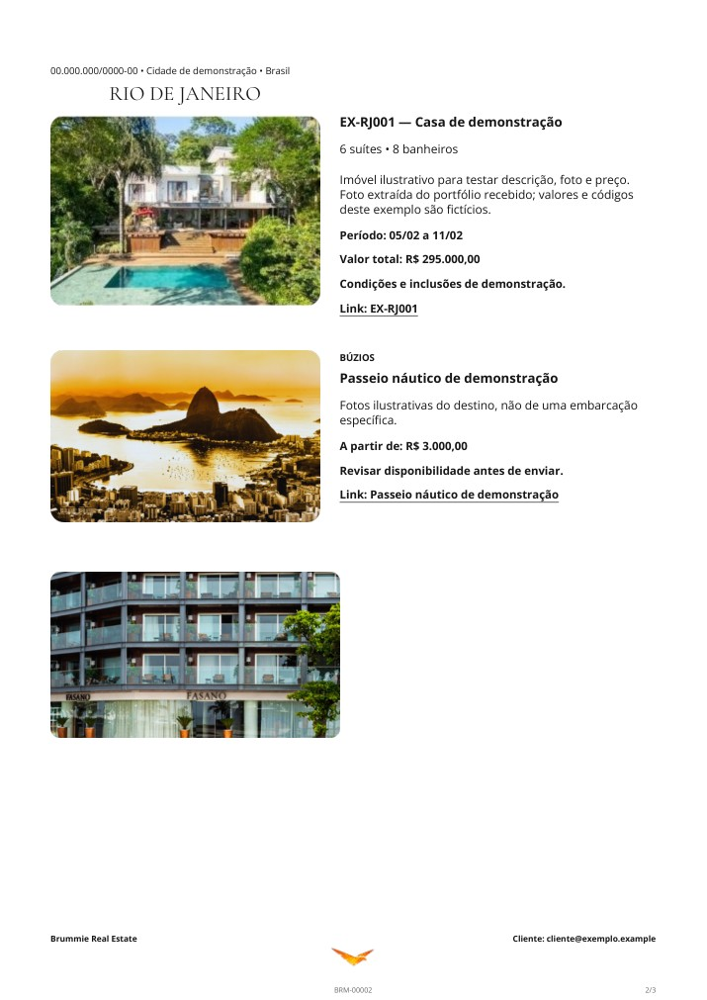
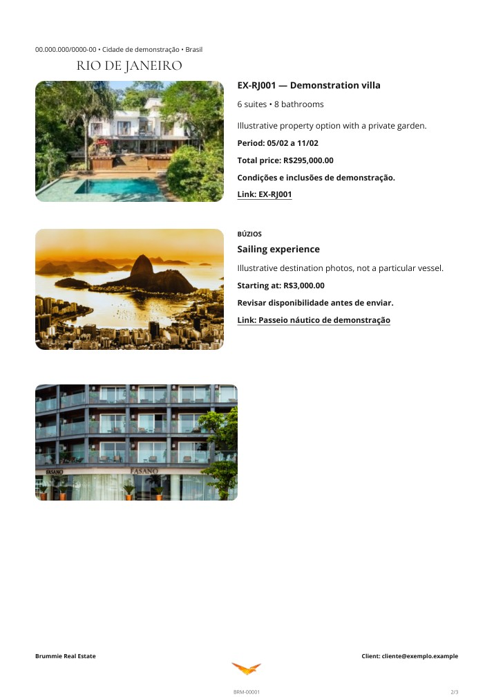
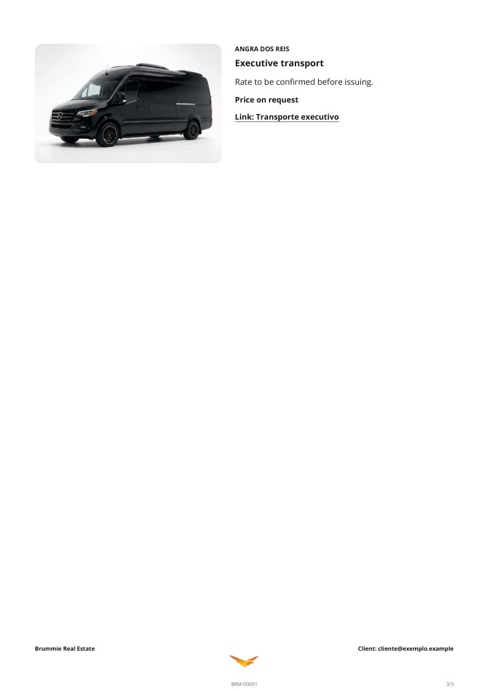

# Proposta composta em português ou inglês

Exemplo fictício com imóvel, experiência náutica, transporte sem preço informado e fotos complementares ilustrativas. Os dois idiomas são documentos separados; não há soma global de alternativas.

## Português

## English

